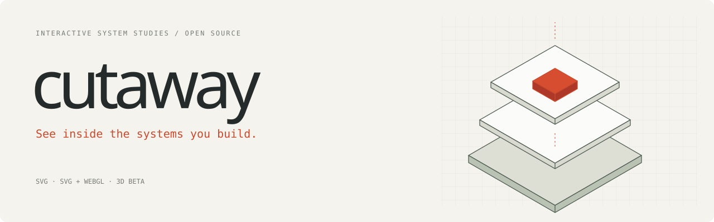
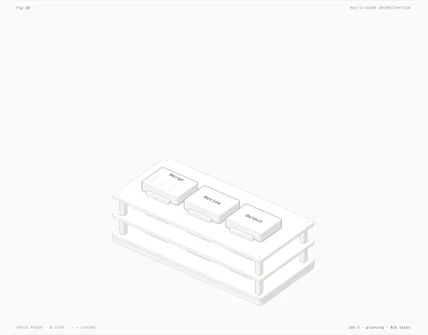
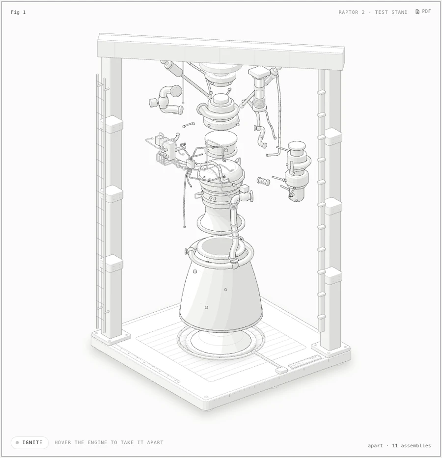
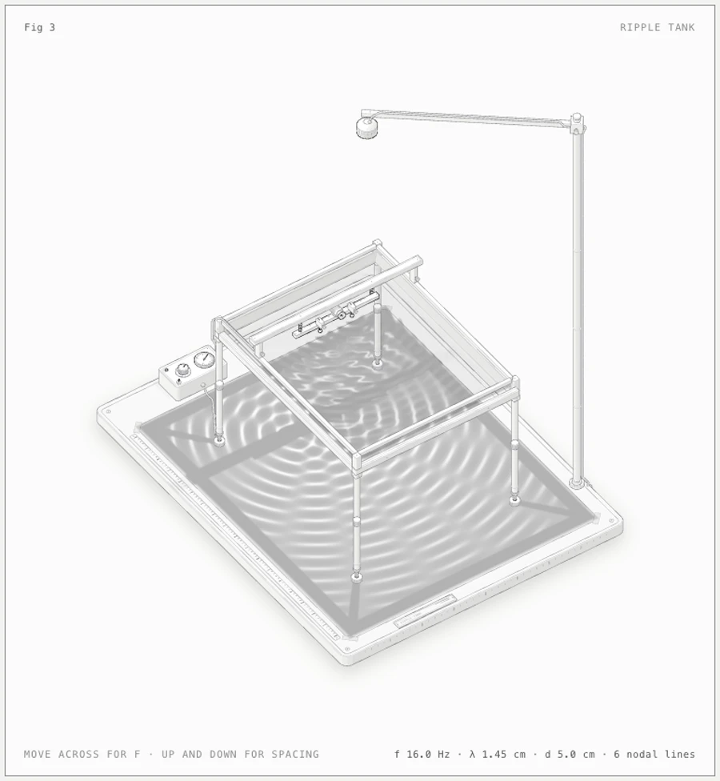
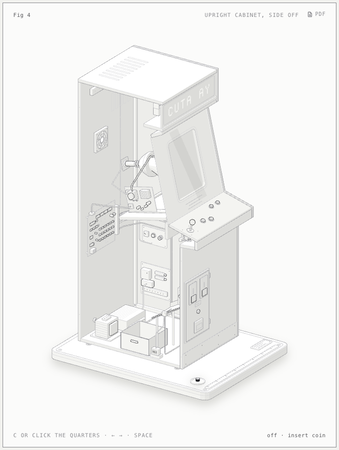
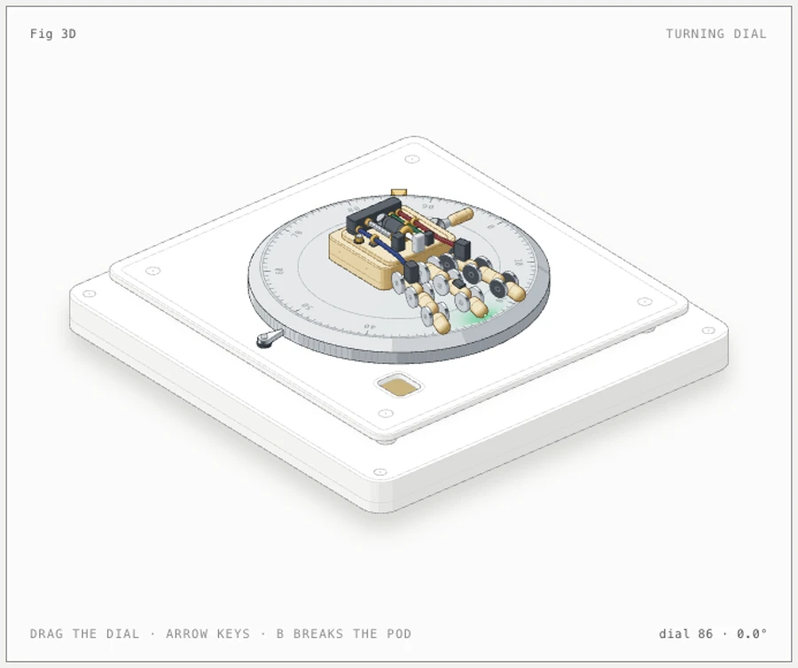
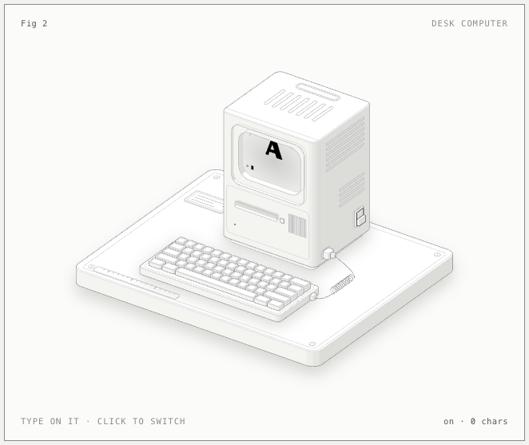
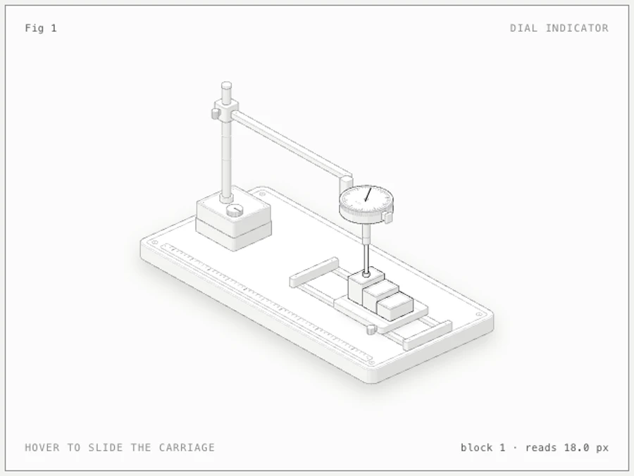

<p align="center">
  
</p>

<p align="center"><b>An agent skill that explains a system by opening it up.</b><br>Interactive isometric cutaways of software, infrastructure, AI agents, and machines, in SVG, WebGL, and 3D.<br>Works in Claude Code, Codex, OpenCode, Antigravity, and MiniMax Code.</p>

<p align="center">
  <a href="https://github.com/irishabh96/cutaway/actions/workflows/ci.yml"></a>
  <a href="https://github.com/irishabh96/cutaway/releases/latest"></a>
  <a href="https://agentskills.io"></a>
  <a href="https://code.claude.com/docs/en/skills"></a>
  <a href="#requirements"></a>
  <a href="kit/"></a>
  <a href="LICENSE"></a>
</p>

<p align="center">
  <a href="https://cutaway.phasr.sh"></a>
  &nbsp;
  <a href="#install"></a>
  &nbsp;
  <a href="https://github.com/irishabh96/cutaway/archive/refs/heads/main.zip"></a>
</p>

<p align="center">
  <a href="#quick-start">Quick start</a> ·
  <a href="#gallery">Gallery</a> ·
  <a href="#what-it-makes">What it makes</a> ·
  <a href="#install">Install</a> ·
  <a href="#usage">Usage</a> ·
  <a href="#examples">Examples</a> ·
  <a href="#build-verify-record">Build &amp; record</a> ·
  <a href="#how-it-works">How it works</a> ·
  <a href="#limits">Limits</a>
</p>

<p align="center">
  <a href="https://cutaway.phasr.sh/examples/multi-agent-orchestration/multi-agent-orchestration-light.html"></a>
</p>

<p align="center"><sub><code>examples/multi-agent-orchestration</code>, light theme. Six tasks, three workers, one review barrier. Open the layers, change parallelism, and step the model. <a href="https://cutaway.phasr.sh/examples/multi-agent-orchestration/multi-agent-orchestration-light.html">Try it live →</a></sub></p>

---

Most architecture diagrams are boxes and arrows that sit still. Ask your coding agent for a Cutaway and you get the system itself, drawn as a solid isometric object you can take apart: open the control plane, follow one request through the workers, drag a slider and watch the queue back up.

Cutaway draws a **direct architectural view** when the real components explain the system: planners, workers, partitions, caches, KV stores. It switches to a **physical metaphor** when a mechanism makes the behavior clearer, such as a lock whose pins only turn when every key matches. Either way, every number on screen comes from the same small model that moves the parts, and the agent checks its own work with geometry audits and close-up screenshots before it hands the figure over.

## Quick start

```sh
npx skills add irishabh96/cutaway -g
```

The CLI asks which agents to set up. Skip the question with `-a claude-code`, `-a codex`, `-a opencode`, `-a antigravity`, or `-a minimax-code`.

Then ask your agent:

```text
/cutaway explain an agent pipeline: planner, three workers, merge barrier, review.
Open the layers and let me change parallelism. Standalone HTML, both themes.
```

In Codex, type `$cutaway` instead of `/cutaway`. No API keys and no backend: your agent uses its normal model access, and the figure it writes is a static page you own.

## Gallery

<table>
  <tr>
    <td width="50%"><a href="https://cutaway.phasr.sh/examples/raptor-engine/raptor-engine-light.html"></a></td>
    <td width="50%"><a href="https://cutaway.phasr.sh/examples/ripple-tank/ripple-tank-light.html"></a></td>
  </tr>
  <tr>
    <td><sub><b>Raptor test stand</b> · SVG + WebGL. Hover to take the engine apart into 11 assemblies, press <kbd>I</kbd> to fire a shader plume. The audit proves no pipe passes through anything in any pose.</sub></td>
    <td><sub><b>Ripple tank</b> · SVG + WebGL. Two WebGL layers, lamp light and caustics, registered to the drawing's own isometric camera and driven by a wave model.</sub></td>
  </tr>
  <tr>
    <td><a href="https://cutaway.phasr.sh/examples/arcade-cabinet/arcade-cabinet-light.html"></a></td>
    <td><a href="https://cutaway.phasr.sh/examples/turning-dial/turning-dial-light.html"></a></td>
  </tr>
  <tr>
    <td><sub><b>Arcade cabinet</b> · SVG. Drop a quarter: it rolls down the chute, trips the coin switch, sends a pulse along the cable, and warms the CRT into attract mode. About 240 solids.</sub></td>
    <td><sub><b>Turning dial</b> · 3D beta. About 90 parts are re-projected and re-shaded every frame as you drag the dial.</sub></td>
  </tr>
  <tr>
    <td><a href="https://cutaway.phasr.sh/examples/desk-computer/desk-computer-light.html"></a></td>
    <td><a href="https://cutaway.phasr.sh/examples/dial-indicator/dial-indicator-light.html"></a></td>
  </tr>
  <tr>
    <td><sub><b>Desk computer</b> · SVG. Type on the keyboard; the line appears on a CRT drawn in the plane of the case front. Switch it off and the picture collapses to a dot.</sub></td>
    <td><sub><b>Dial indicator</b> · SVG. The smallest study, about 300 lines. Slide the carriage and the needle reads each block.</sub></td>
  </tr>
</table>

Click any image to open the live page. The [showcase](https://cutaway.phasr.sh) adds prompt provenance and source for every study, renderer filters, a prompt workbench, and a light/dark switch. Built pages are committed too: open any `.html` in [`examples/`](examples) locally.

## What it makes

Three renderers share one kit, one camera, four-tone shading, and one set of craft rules.

| Mode | Best for | Delivered as | Studies |
|---|---|---|---|
| **SVG** | Layered architecture, queues, state machines, precise mechanisms. Solid parts painted back to front in a card with a live readout. | Standalone HTML, a lone `.svg` with embedded styles, or React/Next.js components | `multi-agent-orchestration`, `arcade-cabinet`, `desk-computer`, `dial-indicator`, `push-button`, `test-rig`, `spot-plate` |
| **SVG + WebGL** | What lines can't draw: fire, exhaust, water, caustics, light. The shader sits between a back and front SVG in the same camera, and the SVG still reads without WebGL. | Standalone HTML with SVG fallback | `raptor-engine`, `ripple-tank` |
| **3D** <sup>beta</sup> | Parts whose rotation or movement in depth carries the explanation. Moving parts are re-projected and re-shaded each frame; the rest stays static art. | Standalone HTML | `turning-dial` |

Every figure ships in light and dark, with pointer and keyboard controls, and goes still under `prefers-reduced-motion` while its controls keep working.

**On top of the figure itself:**

- **Recordings.** `npm run record` drives a figure on an explicit frame clock and exports MP4, WebM, animated WebP, and GIF for docs, launches, and social posts.
- **Print sheets.** `scripts/print.mjs` freezes poses as vector stills and lays out A4 or US Letter PDFs: a poster, a technical drawing, or a two-page detailed explainer. See [`references/print.md`](references/print.md).
- **A showcase site.** `npm run build:site` turns the examples into a static gallery with source inspection and React previews, ready for GitHub Pages, Vercel, or Cloudflare Pages.

## Install

Cutaway is a standard [Agent Skill](https://agentskills.io): a folder with `SKILL.md` at its root. This repository is that folder.

| Agent | Install for you | Invoke |
|---|---|---|
| **Claude Code** | `npx skills add irishabh96/cutaway -g -a claude-code` | `/cutaway` |
| **Codex** | `npx skills add irishabh96/cutaway -g -a codex` | `$cutaway` |
| **OpenCode** | `npx skills add irishabh96/cutaway -g -a opencode` | `/cutaway` |
| **Antigravity** | `npx skills add irishabh96/cutaway -g -a antigravity` | `/cutaway` |
| **MiniMax Code** | `npx skills add irishabh96/cutaway -g -a minimax-code` | `/cutaway` |

Drop `-g` to install into the current project instead, so your team gets it from the repo.

<details>
<summary><b>With git</b></summary>

<br>

Clone into your agent's skills folder so that `SKILL.md` ends up at `<skills folder>/cutaway/SKILL.md`:

| Agent | For you | For one project |
|---|---|---|
| Claude Code | `~/.claude/skills/cutaway` | `.claude/skills/cutaway` |
| Codex | `~/.agents/skills/cutaway` | `.agents/skills/cutaway` |
| OpenCode | `~/.config/opencode/skills/cutaway` | `.opencode/skills/cutaway` |
| Antigravity | `~/.gemini/antigravity/skills/cutaway` | `.agents/skills/cutaway` |
| MiniMax Code | `~/.minimax/skills/cutaway` | `.minimax/skills/cutaway` |

```sh
git clone https://github.com/irishabh96/cutaway.git ~/.claude/skills/cutaway
```

To update, run `git pull --ff-only` inside that folder.

</details>

<details>
<summary><b>Download, without git</b></summary>

<br>

macOS or Linux, for Claude Code (swap the destination for another agent from the table above):

```sh
mkdir -p ~/.claude/skills/cutaway && curl -fsSL https://github.com/irishabh96/cutaway/archive/refs/heads/main.tar.gz | tar -xz --strip-components=1 -C ~/.claude/skills/cutaway
```

Windows PowerShell, for Codex:

```powershell
$cutawayDir = Join-Path $env:USERPROFILE '.agents/skills/cutaway'; $cutawayArchive = Join-Path ([IO.Path]::GetTempPath()) ([IO.Path]::GetRandomFileName() + '.tar.gz'); New-Item -ItemType Directory -Force $cutawayDir | Out-Null; Invoke-WebRequest 'https://github.com/irishabh96/cutaway/archive/refs/heads/main.tar.gz' -OutFile $cutawayArchive; if ($?) { tar -xzf $cutawayArchive --strip-components=1 -C $cutawayDir }; Remove-Item -LiteralPath $cutawayArchive
```

Or [download the ZIP](https://github.com/irishabh96/cutaway/archive/refs/heads/main.zip), unpack it, rename `cutaway-main` to `cutaway`, and move it into a skills folder.

</details>

<details>
<summary><b>Troubleshooting</b></summary>

<br>

- **Skill doesn't show up:** check that `cutaway/SKILL.md` sits directly in a skills folder, then restart the agent (Claude Code can also `/reload-skills`).
- **Chrome not found:** install Chrome or Chromium, or set `CHROME_PATH`. You only need it for the agent's visual checks, not to open a figure.
- **Codex blocks the browser checks:** headless Chrome writes a temporary profile and opens a local port. Approve that command when Codex asks, or run the check in a normal terminal. The figure is still built either way.
- **Wrong theme:** standalone pages pick their theme at build time. Rebuild with `--light`.

More in the [getting started guide](docs/getting-started.md#troubleshooting).

</details>

## Usage

Tell Cutaway what the reader should understand, which real quantities matter, what they can change, and where the figure will live:

```text
/cutaway explain [system] using [direct architecture | a physical metaphor].
Model [counts, rates, states]. Let readers [interaction].
Deliver [HTML | SVG | React], [light | dark | both themes].
```

You don't have to name the skill. Asking your agent for an isometric illustration, an interactive explainer, or a figure for docs or a landing page loads it too.

<details>
<summary><b>More prompts</b>, from the <a href="docs/usage-and-prompts.md">prompt cookbook</a></summary>

<br>

```text
/cutaway three edge clients sharing a token bucket through one atomic coordinator. Capacity 12, refill 3 tokens per second, adjustable combined demand. Open the coordinator, step individual seconds, show accepted and throttled requests. Standalone HTML, both themes.
```

```text
/cutaway a five-node Raft cluster as an openable architectural model. Show terms, leader election, replicated log entries, and commit only after a majority. Let me isolate one follower or the leader and step messages. Pure SVG, light and dark.
```

```text
/cutaway one decoder inference step: embeddings, attention, KV cache, feed-forward network, and output sampling. Open the attention layer and show what the KV cache reuses across tokens. Direct architecture, SVG first, both themes.
```

```text
/cutaway a small HNSW-inspired vector search index with a fixed, visible dataset. Open graph layers and step a query from coarse entry point to local neighbors. Show visited nodes and distance evaluations. Pure SVG.
```

The cookbook has fourteen recipes, covering Kafka partitions, B-tree splits, zero-knowledge proofs, connection pools, cache hierarchies, a Bunsen burner in WebGL, and a differential in 3D.

</details>

Three habits get the best figures:

1. **Name the idea and give real numbers.** Sizes, counts, rates, thresholds. The model behind the figure is only as true as what you tell it.
2. **Pick the view, or let Cutaway pick.** Ask for direct architecture or a physical metaphor explicitly, or describe the system and let the agent choose what explains it best.
3. **Say where it will live.** A standalone page, a lone SVG, or a React/Next.js component, light or dark. The build differs for each.

A figure arrives as source you own: a Node build script and the page it writes, or, for React, geometry modules plus server and client components. The kit comes with it.

## Examples

Each framework-free study has a build script that writes standalone pages next to itself. Add `--light` for the light theme; kit-based builds also take `--audit` to run the geometry audit.

| Study | What it shows | Renderer | Build |
|---|---|---|---|
| [Multi-agent orchestration](examples/multi-agent-orchestration) | A planner, three workers, a merge barrier, and review. Open the control plane, vary parallelism, and step a pure model. | SVG | `node examples/multi-agent-orchestration/build.mjs` |
| [Raptor test stand](examples/raptor-engine) | A Raptor 2 engine that comes apart into 11 assemblies, with a WebGL plume, shock, splash, and steam. The reference for dense pipework and the audit. | SVG + WebGL | `node examples/raptor-engine/build.mjs` |
| [Ripple tank](examples/ripple-tank) | Two dippers, a sheet of water, and the interference pattern projected onto paper below. | SVG + WebGL | `node examples/ripple-tank/build.mjs` |
| [Turning dial](examples/turning-dial) | A robot hand turns a combination dial in true 3D. `stress.mjs` is a 380-part scene for performance. | 3D beta | `node examples/turning-dial/build.mjs` |
| [Arcade cabinet](examples/arcade-cabinet) | Follow a coin through the chute, a pulse along the cable, and a CRT into attract mode. Also prints. | SVG | `node examples/arcade-cabinet/build.mjs` |
| [Desk computer](examples/desk-computer) | A keyboard you can type on and a CRT drawn in the plane of the case. About 85 solids. | SVG | `node examples/desk-computer/build.mjs` |
| [Dial indicator](examples/dial-indicator) | The smallest study, about 300 lines. Start here. | SVG | `node examples/dial-indicator/build.mjs` |
| [Push button](examples/push-button) | A spring-loaded mechanism with printable engineering sheets. | SVG | `node examples/push-button/build.mjs` |
| [Press and pull](examples/test-rig) | A glass button on springs, a finger probe, and a dial gauge. Copy into a React app. | React / SVG | none |
| [Spot plate](examples/spot-plate) | Glass drops that run together as a fan of feeler blades opens. Copy into a React app. | React / SVG | none |
| [CADDi live pitch](examples/caddi-pitch) | A Three.js, GSAP, GLSL, and Web Audio pitch deck. [Watch it](https://cutaway.phasr.sh/showcase/caddi-pitch/). | Three.js | `node examples/caddi-pitch/build.mjs` |

Some studies predate prompt recording. The showcase labels each prompt as either the real implementation brief or a reproduction recipe.

## Build, verify, record

The kit and standalone builds use only Node built-ins. The development packages are for the website, React previews, tests, and video encoding:

```sh
git clone https://github.com/irishabh96/cutaway.git
cd cutaway
npm ci
npm run build      # every example, then the site
npm run dev        # local showcase
```

```sh
npm test                 # regression tests
npm run verify           # headless Chrome checks of every example
npm run record -- --example multi-agent-orchestration --theme light --fps 60 --seconds 6 --format all
```

`npm run record:all` records every study in the catalog. Recording samples a frame clock offline, so 60 fps output isn't a real-time performance claim. CI rebuilds every example on each push, fails if a committed page changes, and deploys the showcase from `main`.

## How it works

- **[`SKILL.md`](SKILL.md)** is what the agent reads. It sets the workflow: gather the true numbers, choose a direct view or a metaphor, write a parts list, build the geometry once with the kit, paint back to front, frame it, make it live, then verify it like a critic.
- **[`kit/`](kit)** is the drawing library: the isometric camera and solids (`iso-kit`), round parts on any axis (`lathe`), pipes and cables (`tube`), the WebGL layer (`gl`), the 3D runtime (`turn*`), and React components. No runtime dependencies.
- **[`references/`](references)** are long-form guides the agent opens when it needs them: craft, the kit API, motion, React, WebGL, 3D, verification, print, and a design walkthrough.
- **Verification.** [`kit/audit.mjs`](kit/audit.mjs) proves the geometry: nothing passes through anything, every end sits on a mount, every overlap is drawn in depth order. In headless Chrome, [`capture.mjs`](scripts/capture.mjs) and [`drive.mjs`](scripts/drive.mjs) take screenshots, close-ups, and contact sheets, and [`lines.mjs`](scripts/lines.mjs) fails any line that ends in mid-air. The agent reads every image it makes.

<details>
<summary><b>Repository layout</b></summary>

```text
cutaway/
├── SKILL.md              the skill the agent reads
├── kit/                  the drawing library
│   ├── iso-kit.mjs       camera, solids, parts library (iso-kit.ts types)
│   ├── lathe.mjs         round parts on any axis
│   ├── tube.mjs          pipes, tubes, and cables
│   ├── audit.mjs         the geometry audit
│   ├── gl.mjs            WebGL inside the drawing
│   ├── turn*.mjs         the 3D runtime, builder, and orbit audit (beta)
│   └── react/            server-safe components and client hooks
├── references/           long-form guides: craft, kit, motion, react, webgl, 3d, verify, print
├── scripts/              headless Chrome checks, recording, print, site and example builds
├── examples/             eleven studies, built pages committed, plus catalog.json
├── site/                 the showcase website source
├── docs/                 getting started, prompt cookbook, architecture, video script
├── media/                recordings and posters of every study
├── evals/                test prompts and what a good answer contains
└── .github/              CI, Pages deploy, issue forms, README images
```

</details>

## Requirements

| | Needed for | Notes |
|---|---|---|
| **A coding agent**: [Claude Code](https://code.claude.com/docs/en/overview), [Codex](https://developers.openai.com/codex/skills), [OpenCode](https://opencode.ai/docs/skills/), [Antigravity](https://antigravity.google), or [MiniMax Code](https://github.com/MiniMax-AI/minimax-code) | everything | Follows the open Agent Skills format. |
| **Node.js 20.10+** | builds, kit, checks | Built-in modules only. The `skills` CLI itself needs Node.js 22.20+, as do the website and dev tooling. |
| **Chrome or Chromium** | visual checks, recording, print | Found in the usual places on macOS, Linux, Windows, and Playwright's cache. Set `CHROME_PATH` for anything else. |
| **React 18+** | React output only | `kit/react/`, `examples/test-rig/`, `examples/spot-plate/`. |
| **FFmpeg** | recording only | Installed by `npm ci` on supported platforms, or set `FFMPEG_PATH`. |

## Limits

- **It's not a chart library.** There are no axes or data series. Numbers show up as live readouts driven by a model, and as the real sizes and counts of parts.
- **It's slow on purpose.** A good figure takes a long session: parts list, geometry, audit, and close-ups of every joint in both themes. Dense builds take minutes; a full 3D orbit audit can take 15 to 20 minutes.
- **Models are simplified.** An explainer leaves things out, such as network delay or failover. Ask for the simplifications to be stated on the figure, as the cookbook recipes do, before you publish technical claims.
- **Shaders need WebGL.** Without it the SVG still reads.

> [!NOTE]
> **3D mode is beta.** A small 3D figure runs at 60 fps. The 380-part stress scene runs at about 20 fps at 1440 px wide, and slower on a throttled phone profile. Keep the moving subject small.

## Contributing

Issues and pull requests are welcome. Read [CONTRIBUTING.md](CONTRIBUTING.md) first. A new study needs a pure model, a standalone build or React entry point, both themes, honest prompt provenance, and a catalog entry. Kit changes keep existing defaults and leave the core free of runtime dependencies.

Built something with Cutaway? Share it in [Discussions](https://github.com/irishabh96/cutaway/discussions).

[Report a bug](https://github.com/irishabh96/cutaway/issues/new?template=bug_report.yml) · [Request a study](https://github.com/irishabh96/cutaway/issues/new?template=figure_request.yml) · [Code of Conduct](CODE_OF_CONDUCT.md) · [Security](SECURITY.md) · [Changelog](CHANGELOG.md)

## License

[MIT](LICENSE) © 2026 Rishabh Bhatia. See [LICENSE](LICENSE) for the full copyright notices.

<p align="center"><sub>If Cutaway helped you explain something, a ⭐ helps other people find it.</sub></p>
