<picture>
  <source media="(prefers-color-scheme: dark)" srcset=".github/assets/readme/masthead-dark.svg">
  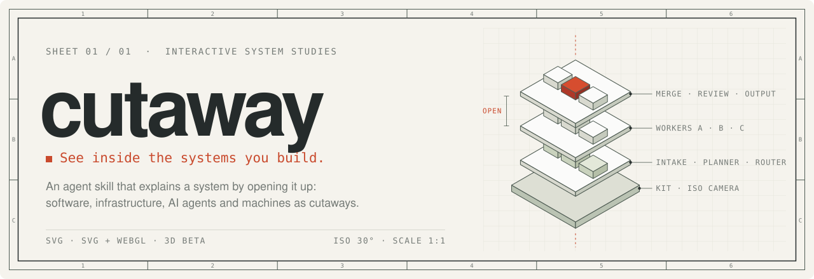
</picture>

<picture>
  <source media="(prefers-color-scheme: dark)" srcset=".github/assets/readme/title-block-dark.svg">
  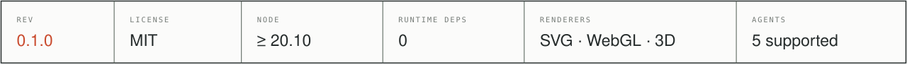
</picture>

<p align="center">
  <a href="#01--quick-start"><b>Quick start</b></a> &nbsp;·&nbsp;
  <a href="#02--plates"><b>Plates</b></a> &nbsp;·&nbsp;
  <a href="#04--install"><b>Install</b></a> &nbsp;·&nbsp;
  <a href="docs/usage-and-prompts.md"><b>Prompt cookbook</b></a> &nbsp;·&nbsp;
  <a href="https://cutaway.phasr.sh"><b>Live showcase</b></a>
</p>

<p align="center"><sub>For <b>Claude Code</b> · <b>Codex</b> · <b>OpenCode</b> · <b>Antigravity</b> · <b>MiniMax Code</b>, or any agent that reads the open <a href="https://agentskills.io">Agent Skills</a> format.</sub></p>

<br>

<p align="center">
  <a href="examples/multi-agent-orchestration">
    <picture>
      <source media="(prefers-color-scheme: dark)" srcset="media/multi-agent-orchestration-dark.gif">
      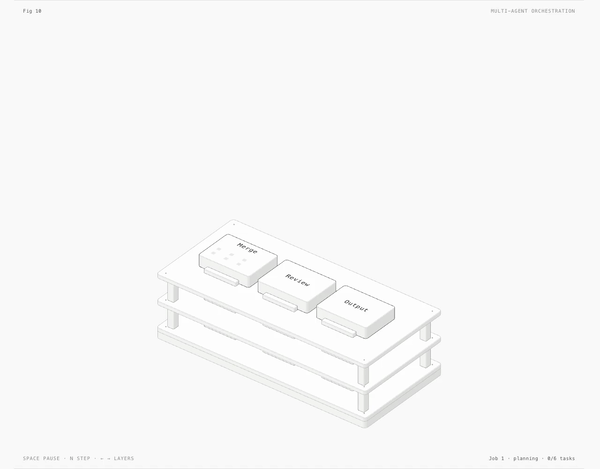
    </picture>
  </a>
</p>

<p align="center"><sub><code>FIG. 1</code> &nbsp; <b>Multi-agent orchestration</b> &nbsp;·&nbsp; SVG &nbsp;·&nbsp; six tasks, three workers, one review barrier &nbsp;·&nbsp; <a href="examples/multi-agent-orchestration"><code>examples/multi-agent-orchestration</code></a></sub></p>

<picture>
  <source media="(prefers-color-scheme: dark)" srcset=".github/assets/readme/rule-dark.svg">
  
</picture>

### Boxes and arrows sit still

<picture>
  <source media="(prefers-color-scheme: dark)" srcset=".github/assets/readme/compare-dark.svg">
  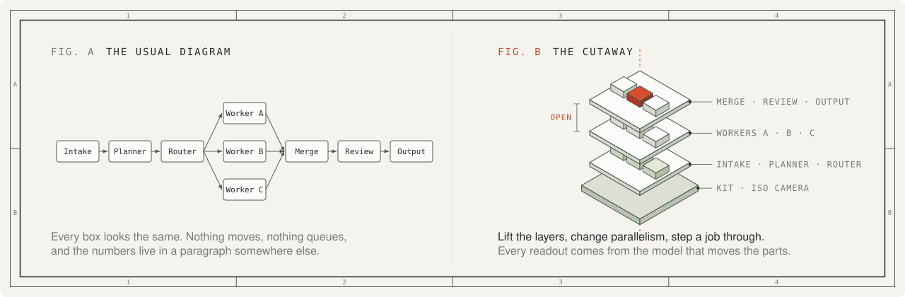
</picture>

An architecture diagram usually tells you *what is connected*. A cutaway also shows you *what happens*. Ask your coding agent for one and you get the system as a solid object on a drawing sheet. You can lift the control plane off the workers, push a request through, or drag a slider and watch the queue back up.

When the real components carry the story (planners, partitions, caches, KV stores), Cutaway draws them directly. When a mechanism explains the behavior better, it builds a **physical metaphor** instead, such as a pin-tumbler lock that only turns when every key matches. In both cases one small model drives the moving parts and the numbers on screen, so they can't drift apart. Before handing anything over, the agent audits the geometry and inspects its own close-ups.

## 01 · Quick start

**1. Install the skill** for every agent on your machine:

```sh
npx skills add irishabh96/cutaway -g
```

The CLI asks which agents to set up. To skip the question, pass `-a claude-code`, `-a codex`, `-a opencode`, `-a antigravity` or `-a minimax-code`.

**2. Describe the system** and what you want to do with it:

```text
/cutaway explain an agent pipeline: planner, three workers, merge barrier, review.
Open the layers and let me change parallelism. Standalone HTML, both themes.
```

In Codex the command is `$cutaway`.

**3. Open the page.** You get a static HTML file, SVG or React component that you own. It needs no API key and no backend, and your agent uses the model access it already has.

## 02 · Plates

Every plate below is a recording of a committed example. Click one to open its source, or open any built `.html` in [`examples/`](examples) in your browser to use it.

<table>
  <tr>
    <td width="33%" valign="top">
      <a href="examples/raptor-engine">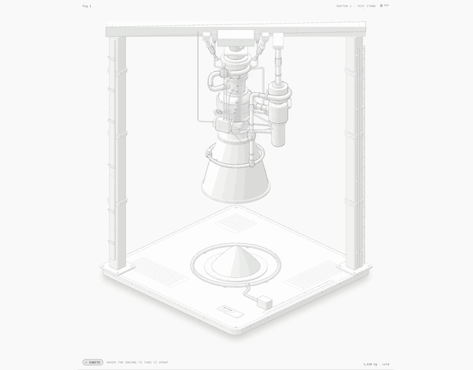</a>
      <br><sub><code>FIG. 2</code> <b>Raptor test stand</b><br>SVG + WebGL · hover to split it into 11 assemblies, press <kbd>I</kbd> to fire.</sub>
    </td>
    <td width="33%" valign="top">
      <a href="examples/ripple-tank">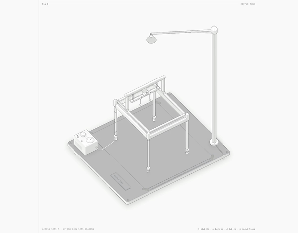</a>
      <br><sub><code>FIG. 3</code> <b>Ripple tank</b><br>SVG + WebGL · lamp light and caustics in the drawing's own camera, driven by a wave model.</sub>
    </td>
    <td width="33%" valign="top">
      <a href="examples/turning-dial">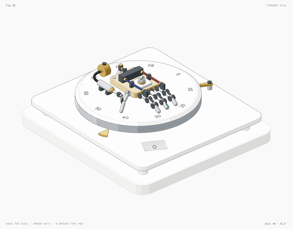</a>
      <br><sub><code>FIG. 4</code> <b>Turning dial</b><br>3D beta · about 90 parts re-projected and re-shaded every frame.</sub>
    </td>
  </tr>
  <tr>
    <td valign="top">
      <a href="examples/arcade-cabinet">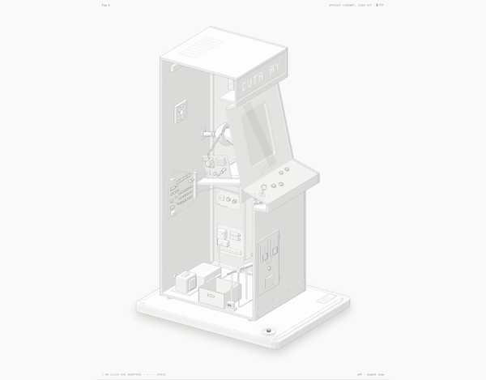</a>
      <br><sub><code>FIG. 5</code> <b>Arcade cabinet</b><br>SVG · drop a quarter and follow it to the CRT. About 240 solids.</sub>
    </td>
    <td valign="top">
      <a href="examples/desk-computer">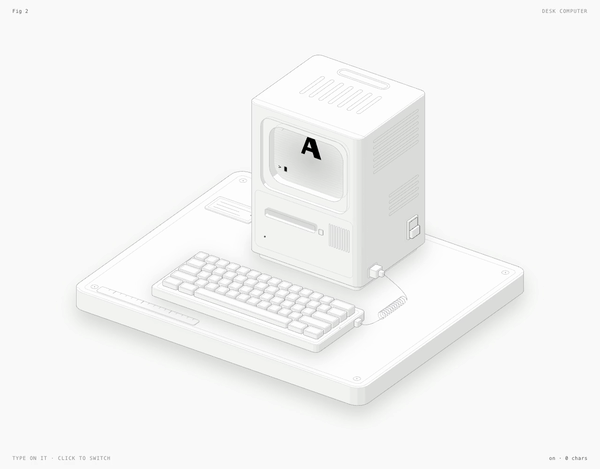</a>
      <br><sub><code>FIG. 6</code> <b>Desk computer</b><br>SVG · type on the keyboard; the CRT is drawn in the plane of the case.</sub>
    </td>
    <td valign="top">
      <a href="examples/dial-indicator">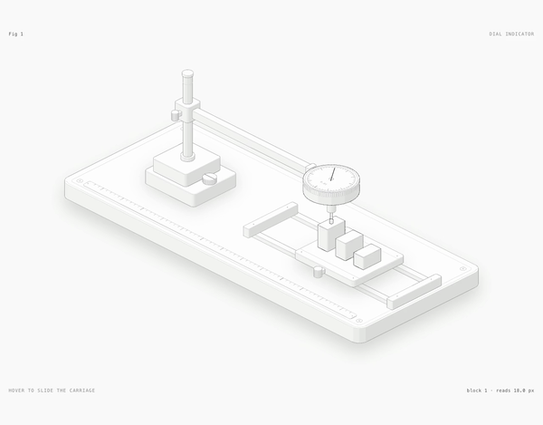</a>
      <br><sub><code>FIG. 7</code> <b>Dial indicator</b><br>SVG · the smallest study, about 300 lines. Start reading here.</sub>
    </td>
  </tr>
  <tr>
    <td valign="top">
      <a href="examples/push-button">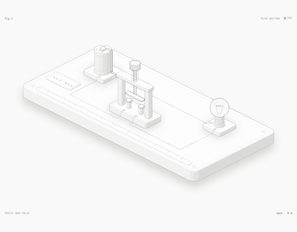</a>
      <br><sub><code>FIG. 8</code> <b>Push button</b><br>SVG · travel and return of a spring, plus printable engineering sheets.</sub>
    </td>
    <td valign="top">
      <a href="examples/test-rig">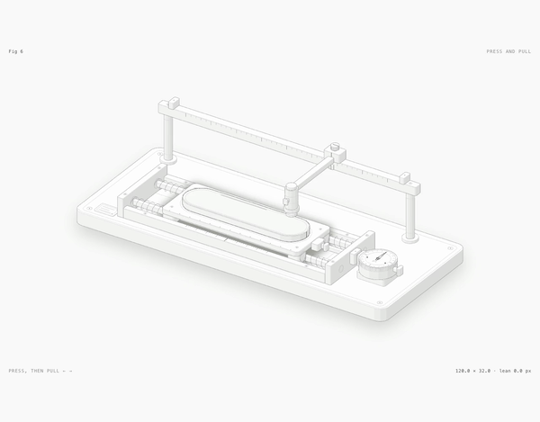</a>
      <br><sub><code>FIG. 9</code> <b>Press and pull</b><br>React / SVG · a finger probe presses and a dial gauge reads the lean.</sub>
    </td>
    <td valign="top">
      <a href="examples/spot-plate">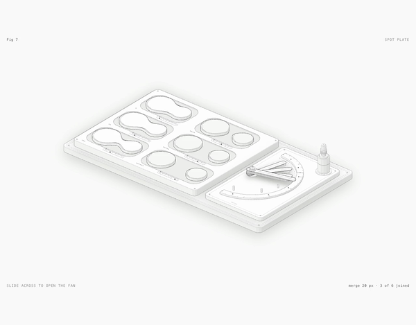</a>
      <br><sub><code>FIG. 10</code> <b>Spot plate</b><br>React / SVG · glass drops run together as a fan of feeler blades opens.</sub>
    </td>
  </tr>
</table>

<details>
<summary><b>Build any plate locally</b></summary>

<br>

Each framework-free study has a build script that writes its standalone pages next to itself. Add `--light` for the light theme. Kit-based builds also take `--audit`, which runs the geometry audit.

| Fig. | Study | Renderer | Build |
|---:|---|---|---|
| 1 | [Multi-agent orchestration](examples/multi-agent-orchestration): open the control plane, vary parallelism, step a pure model | SVG | `node examples/multi-agent-orchestration/build.mjs` |
| 2 | [Raptor test stand](examples/raptor-engine): the reference for dense pipework and the audit | SVG + WebGL | `node examples/raptor-engine/build.mjs` |
| 3 | [Ripple tank](examples/ripple-tank): interference projected onto paper | SVG + WebGL | `node examples/ripple-tank/build.mjs` |
| 4 | [Turning dial](examples/turning-dial): `stress.mjs` is a 380-part performance scene | 3D beta | `node examples/turning-dial/build.mjs` |
| 5 | [Arcade cabinet](examples/arcade-cabinet): coin, cable pulse, attract mode. Also prints | SVG | `node examples/arcade-cabinet/build.mjs` |
| 6 | [Desk computer](examples/desk-computer): about 85 solids | SVG | `node examples/desk-computer/build.mjs` |
| 7 | [Dial indicator](examples/dial-indicator): the smallest study | SVG | `node examples/dial-indicator/build.mjs` |
| 8 | [Push button](examples/push-button): with printable sheets | SVG | `node examples/push-button/build.mjs` |
| 9 | [Press and pull](examples/test-rig): copy into a React app | React / SVG | none |
| 10 | [Spot plate](examples/spot-plate): copy into a React app | React / SVG | none |
| — | [CADDi live pitch](examples/caddi-pitch): Three.js, GSAP, GLSL and Web Audio | Three.js | `node examples/caddi-pitch/build.mjs` |

Some studies were made before prompts were recorded. The showcase marks each prompt as either the real implementation brief or a reproduction recipe.

</details>

## 03 · Renderers

All three renderers share one kit, one isometric camera, four-tone shading and one set of craft rules.

| Renderer | Reach for it when | Ships as |
|---|---|---|
| **SVG** | You need layered architecture, queues, state machines or precise mechanisms. Solid parts are painted back to front inside a card with a live readout. | Standalone HTML, a lone `.svg` with embedded styles, or React/Next.js components |
| **SVG + WebGL** | The subject has fire, exhaust, water, caustics or light, which lines can't draw. The shader sits between a back and a front SVG in the same camera, and the figure still reads without WebGL. | Standalone HTML with an SVG fallback |
| **3D** <sup>beta</sup> | The explanation is in a rotation or a movement in depth. The moving parts are re-projected and re-shaded every frame; the rest stays static art. | Standalone HTML |

Every figure comes in light and dark, works with pointer and keyboard, and stops moving under `prefers-reduced-motion` while its controls keep working.

**Beyond the figure:**

- **Recordings.** `npm run record` steps a figure on an explicit frame clock and exports MP4, WebM, animated WebP and GIF. The plates above were made this way.
- **Print sheets.** `scripts/print.mjs` freezes poses as vector stills and lays them out as A4 or US Letter PDFs: a poster, a technical drawing, or a two-page explainer. See [`references/print.md`](references/print.md).
- **A showcase site.** `npm run build:site` turns the examples into a static gallery with source inspection and React previews, ready for GitHub Pages, Vercel or Cloudflare Pages.

<picture>
  <source media="(prefers-color-scheme: dark)" srcset=".github/assets/readme/rule-dark.svg">
  
</picture>

## 04 · Install

Cutaway is a standard [Agent Skill](https://agentskills.io), which means a folder with `SKILL.md` at its root. This repository is that folder.

| Agent | One command | Then type |
|---|---|---|
| **Claude Code** | `npx skills add irishabh96/cutaway -g -a claude-code` | `/cutaway` |
| **Codex** | `npx skills add irishabh96/cutaway -g -a codex` | `$cutaway` |
| **OpenCode** | `npx skills add irishabh96/cutaway -g -a opencode` | `/cutaway` |
| **Antigravity** | `npx skills add irishabh96/cutaway -g -a antigravity` | `/cutaway` |
| **MiniMax Code** | `npx skills add irishabh96/cutaway -g -a minimax-code` | `/cutaway` |

Without `-g`, the skill installs into the current project, and your team gets it when they clone the repo.

<details>
<summary><b>With git</b></summary>

<br>

Clone so that `SKILL.md` ends up at `<skills folder>/cutaway/SKILL.md`:

| Agent | For you | For one project |
|---|---|---|
| Claude Code | `~/.claude/skills/cutaway` | `.claude/skills/cutaway` |
| Codex | `~/.agents/skills/cutaway` | `.agents/skills/cutaway` |
| OpenCode | `~/.config/opencode/skills/cutaway` | `.opencode/skills/cutaway` |
| Antigravity | `~/.gemini/antigravity/skills/cutaway` | `.agents/skills/cutaway` |
| MiniMax Code | `~/.minimax/skills/cutaway` | `.minimax/skills/cutaway` |

```sh
git clone https://github.com/irishabh96/cutaway.git ~/.claude/skills/cutaway
```

To update, run `git pull --ff-only` in that folder.

</details>

<details>
<summary><b>Without git</b></summary>

<br>

On macOS or Linux, for Claude Code (use another destination from the table above for a different agent):

```sh
mkdir -p ~/.claude/skills/cutaway && curl -fsSL https://github.com/irishabh96/cutaway/archive/refs/heads/main.tar.gz | tar -xz --strip-components=1 -C ~/.claude/skills/cutaway
```

On Windows PowerShell, for Codex:

```powershell
$cutawayDir = Join-Path $env:USERPROFILE '.agents/skills/cutaway'; $cutawayArchive = Join-Path ([IO.Path]::GetTempPath()) ([IO.Path]::GetRandomFileName() + '.tar.gz'); New-Item -ItemType Directory -Force $cutawayDir | Out-Null; Invoke-WebRequest 'https://github.com/irishabh96/cutaway/archive/refs/heads/main.tar.gz' -OutFile $cutawayArchive; if ($?) { tar -xzf $cutawayArchive --strip-components=1 -C $cutawayDir }; Remove-Item -LiteralPath $cutawayArchive
```

Or [download the ZIP](https://github.com/irishabh96/cutaway/archive/refs/heads/main.zip), unpack it, rename `cutaway-main` to `cutaway`, and move it into a skills folder.

</details>

<details>
<summary><b>If something goes wrong</b></summary>

<br>

- **The skill doesn't appear.** Check that `cutaway/SKILL.md` sits directly inside a skills folder, then restart the agent. In Claude Code, `/reload-skills` also works.
- **Chrome can't be found.** Install Chrome or Chromium, or set `CHROME_PATH`. Chrome is only needed for the agent's visual checks, not for opening a figure.
- **Codex blocks the browser checks.** Headless Chrome writes a temporary profile and opens a local port. Approve that command when Codex asks, or run the check in a normal terminal. The figure gets built either way.
- **The theme is wrong.** Standalone pages choose their theme at build time, so rebuild with `--light`.

The [getting started guide](docs/getting-started.md#troubleshooting) covers more.

</details>

## 05 · Prompting

A good brief tells the agent four things: what the reader should understand, which real quantities matter, what the reader can change, and where the figure will live.

```text
/cutaway explain [system] using [direct architecture | a physical metaphor].
Model [counts, rates, states]. Let readers [interaction].
Deliver [HTML | SVG | React], [light | dark | both themes].
```

You don't need the slash command. Asking your agent for an isometric illustration, an interactive explainer, or a figure for docs or a landing page loads the skill too.

- **Real numbers make real figures.** Capacities, rates, thresholds and counts go straight into the model, and the model drives everything on screen.
- **Choose the view, or leave it to the agent.** Ask for direct architecture or a metaphor by name. If you just describe the system, the agent picks whichever explains it best.
- **Name the destination.** A standalone page, a lone SVG and a React/Next.js component are built differently, and so are light and dark themes.

<details>
<summary><b>Four prompts from the <a href="docs/usage-and-prompts.md">cookbook</a></b></summary>

<br>

```text
/cutaway three edge clients sharing a token bucket through one atomic coordinator. Capacity 12, refill 3 tokens per second, adjustable combined demand. Open the coordinator, step individual seconds, show accepted and throttled requests. Standalone HTML, both themes.
```

```text
/cutaway a five-node Raft cluster as an openable architectural model. Show terms, leader election, replicated log entries, and commit only after a majority. Let me isolate one follower or the leader and step messages. Pure SVG, light and dark.
```

```text
/cutaway one decoder inference step: embeddings, attention, KV cache, feed-forward network, and output sampling. Open the attention layer and show what the KV cache reuses across tokens. Direct architecture, SVG first, both themes.
```

```text
/cutaway a small HNSW-inspired vector search index with a fixed, visible dataset. Open graph layers and step a query from coarse entry point to local neighbors. Show visited nodes and distance evaluations. Pure SVG.
```

The cookbook has fourteen recipes in all, including Kafka partitions, B-tree splits, zero-knowledge proofs, connection pools, cache hierarchies, a Bunsen burner in WebGL and a differential in 3D.

</details>

What you get back is source code, not a screenshot: a Node build script and the page it writes or, for React, geometry modules plus server and client components. The kit travels with it.

<picture>
  <source media="(prefers-color-scheme: dark)" srcset=".github/assets/readme/rule-dark.svg">
  
</picture>

## 06 · How it works

<picture>
  <source media="(prefers-color-scheme: dark)" srcset=".github/assets/readme/pipeline-dark.svg">
  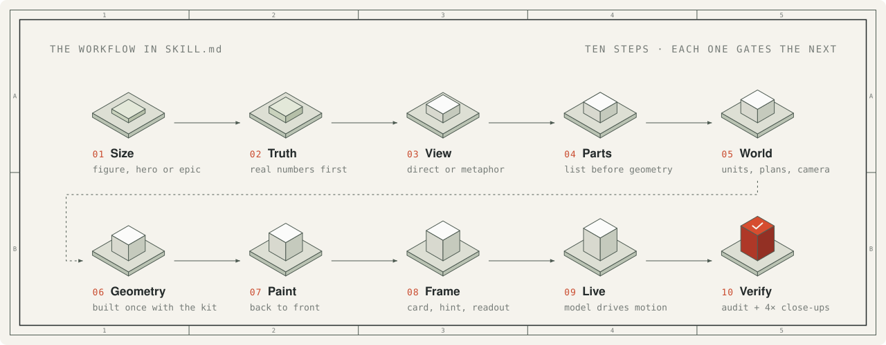
</picture>

| Part | Role |
|---|---|
| [**`SKILL.md`**](SKILL.md) | What the agent reads. It sets the ten-step workflow above, from sizing the job to verifying the result like a critic. |
| [**`kit/`**](kit) | The drawing library: the isometric camera and solids (`iso-kit`), round parts on any axis (`lathe`), pipes and cables (`tube`), the WebGL layer (`gl`), the 3D runtime (`turn*`) and React components. It has no runtime dependencies. |
| [**`references/`**](references) | Long-form guides the agent opens only when it needs them: craft, kit API, motion, React, WebGL, 3D, verification, print and a design walkthrough. |
| [**`kit/audit.mjs`**](kit/audit.mjs) | Proves the geometry: nothing passes through anything, every end sits on a mount, and every overlap is painted in depth order. |
| [**`scripts/`**](scripts) | Headless Chrome checks. [`capture.mjs`](scripts/capture.mjs) and [`drive.mjs`](scripts/drive.mjs) take screenshots, close-ups and contact sheets, and [`lines.mjs`](scripts/lines.mjs) fails any line that ends in mid-air. The agent reads every image it produces. |

<details>
<summary><b>Repository layout</b></summary>

```text
cutaway/
├── SKILL.md              the skill the agent reads
├── kit/                  the drawing library
│   ├── iso-kit.mjs       camera, solids, parts library (iso-kit.ts types)
│   ├── lathe.mjs         round parts on any axis
│   ├── tube.mjs          pipes, tubes, and cables
│   ├── audit.mjs         the geometry audit
│   ├── gl.mjs            WebGL inside the drawing
│   ├── turn*.mjs         the 3D runtime, builder, and orbit audit (beta)
│   └── react/            server-safe components and client hooks
├── references/           long-form guides: craft, kit, motion, react, webgl, 3d, verify, print
├── scripts/              headless Chrome checks, recording, print, site and example builds
├── examples/             eleven studies, built pages committed, plus catalog.json
├── site/                 the showcase website source
├── docs/                 getting started, prompt cookbook, architecture, video script
├── media/                recordings and posters of every study
├── evals/                test prompts and what a good answer contains
└── .github/              CI, Pages deploy, issue forms, README artwork
```

</details>

## 07 · Build, verify, record

The kit and the standalone builds use only Node built-ins. The development packages are for the website, React previews, tests and video encoding.

```sh
git clone https://github.com/irishabh96/cutaway.git && cd cutaway
npm ci
npm run build      # every example, then the site
npm run dev        # local showcase
```

```sh
npm test                 # regression tests
npm run verify           # headless Chrome checks of every example
npm run record -- --example multi-agent-orchestration --theme light --fps 60 --seconds 6 --format all
```

`npm run record:all` records every study in the catalog. Frames are sampled offline on a clock, so 60 fps output says nothing about real-time performance. On every push, CI rebuilds all the examples, fails if a committed page changes, and deploys the showcase from `main`. The README artwork is generated by `node scripts/readme-art.mjs`.

## 08 · Tolerances

What you need:

| | Needed for | Notes |
|---|---|---|
| **A coding agent**: [Claude Code](https://code.claude.com/docs/en/overview), [Codex](https://developers.openai.com/codex/skills), [OpenCode](https://opencode.ai/docs/skills/), [Antigravity](https://antigravity.google) or [MiniMax Code](https://github.com/MiniMax-AI/minimax-code) | everything | Uses the open Agent Skills format. |
| **Node.js 20.10+** | builds, kit, checks | Built-in modules only. The `skills` CLI, the website and the dev tooling need Node.js 22.20+. |
| **Chrome or Chromium** | visual checks, recording, print | Found in the usual places on macOS, Linux and Windows, and in Playwright's cache. Set `CHROME_PATH` for anything else. |
| **React 18+** | React output only | `kit/react/`, `examples/test-rig/`, `examples/spot-plate/`. |
| **FFmpeg** | recording only | `npm ci` installs it on supported platforms, or set `FFMPEG_PATH`. |

Where it stops:

- **Explainers, not charts.** There are no axes or data series. Numbers appear as live readouts from a model, and as the real sizes and counts of the parts.
- **Quality takes time.** A finished figure needs a parts list, geometry, an audit, and close-ups of every joint in both themes. Dense builds take minutes, and a full 3D orbit audit can take 15 to 20 minutes.
- **Simplified models.** An explainer leaves things out, such as network delay or failover. Before you publish technical claims, ask for the simplifications to be stated on the figure, as the cookbook recipes do.
- **WebGL for shaders.** Without WebGL the SVG still reads.

> [!NOTE]
> **The 3D renderer is in beta.** A small 3D figure runs at 60 fps. The 380-part stress scene runs at about 20 fps at 1440 px wide, and slower on a throttled phone profile, so keep the moving subject small.

<picture>
  <source media="(prefers-color-scheme: dark)" srcset=".github/assets/readme/rule-dark.svg">
  
</picture>

## Contributing

Issues and pull requests are welcome; start with [CONTRIBUTING.md](CONTRIBUTING.md). A new study needs a pure model, a standalone build or React entry point, both themes, honest prompt provenance and a catalog entry. Kit changes must keep existing defaults and add no runtime dependencies to the core.

If you made something with Cutaway, post it in [Discussions](https://github.com/irishabh96/cutaway/discussions).

[Report a bug](https://github.com/irishabh96/cutaway/issues/new?template=bug_report.yml) · [Request a study](https://github.com/irishabh96/cutaway/issues/new?template=figure_request.yml) · [Code of Conduct](CODE_OF_CONDUCT.md) · [Security](SECURITY.md) · [Changelog](CHANGELOG.md)

<br>

| DRAWN BY | LICENSE | SHEET |
|---|---|---|
| Rishabh Bhatia | [MIT](LICENSE) © 2026 Rishabh Bhatia. See [LICENSE](LICENSE) for the full copyright notices. | 01 / 01 |

<p align="center"><sub>Made something click? ⭐ the repo so the next engineer finds it too.</sub></p>
